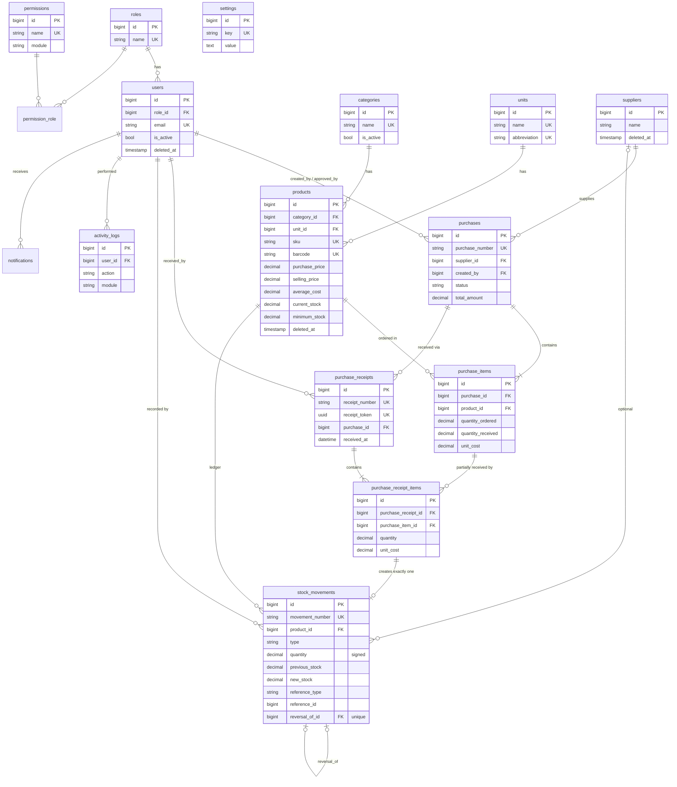

# IMS Database Design (Phase 2)

Database: MySQL 8 / MariaDB 10.4+ (InnoDB, utf8mb4). Laravel's default tables
(`password_reset_tokens`, `sessions`, `cache`, `jobs`, ...) are not shown.

## ERD



## Key design rules

| Rule from the spec | How the schema enforces it |
|---|---|
| Stock cannot be negative | `CHECK (current_stock >= 0)` on products and on every movement row |
| Every stock change is recorded | Only `StockService` changes `current_stock` (not fillable); it always inserts a `stock_movements` row |
| History is auditable and immutable | `StockMovement` model throws on update/delete; corrections are new rows with `reversal_of_id` |
| A movement can only be reversed once | `reversal_of_id` is UNIQUE |
| Prevent duplicate receiving | `purchase_receipts.receipt_token` UNIQUE (stops double-submit) and `stock_movements(reference_type, reference_id)` UNIQUE (one movement per receipt line) |
| Never receive more than ordered | `CHECK (quantity_received <= quantity_ordered)` plus validation in the service |
| Creating a PO doesn't change stock | Only receipts create movements |
| Can't delete categories/units in use | Foreign keys use `RESTRICT`; archived products still count |
| Deleted records don't break reports | Products, suppliers and users use soft deletes; relations use `withTrashed()` |
| Money / fractional quantities | `DECIMAL(15,2)` money, `DECIMAL(15,4)` unit cost, `DECIMAL(15,3)` quantities |
| No duplicate low-stock alerts | `products.low_stock_alerted_at` is set when alerted, cleared when restocked above minimum |

Reconciliation check (should always return 0 rows):

```sql
SELECT p.id, p.sku, p.current_stock, COALESCE(SUM(m.quantity), 0) AS ledger_total
FROM products p LEFT JOIN stock_movements m ON m.product_id = p.id
GROUP BY p.id, p.sku, p.current_stock
HAVING p.current_stock <> ledger_total;
```

## Inventory valuation: weighted average cost

On every stock increase that carries a cost (purchase receipt, manual stock-in with cost):

```
new_average_cost = (current_stock * average_cost + qty_in * unit_cost) / (current_stock + qty_in)
```

Stock-outs do not change `average_cost`; each OUT movement stores the average cost at that
moment in `unit_cost`, so the cost of goods issued is reproducible later.

Inventory value = `SUM(current_stock * average_cost)`.

## Roles (default permissions, editable by Admin)

| Role | Summary |
|---|---|
| Admin | Everything (always passes every permission check) |
| Manager | Products, categories, units, suppliers, purchases (create/approve/receive/cancel), stock in/out/adjust/reverse, reports + export |
| Staff | Dashboard, view products, stock history, stock out, notifications. Stock in only if Admin grants `stock.in` |
| Viewer | Dashboard, view products and stock balances, view reports. No create/update/delete |
